# Afterfetch

<p align="center"></p>

<p align="center">
  <a href="https://github.com/liminal-hq-labs/afterfetch/actions/workflows/ci.yml"></a>
  
  
</p>

A tiny system-information command with an Afterglow sun for every system, from DOS to macOS.

Afterfetch prints a short, neofetch-style summary of the system it runs on, beside a different Afterglow sun for each kind of system. It is one tiny static program per platform, with no libc and no runtime to install.

> **Status:** experimental, no releases. The Linux x86_64 and i586 builds run; all eight logos are drawn, and the program draws them once the core's decoder lands. The Win32 i586 and x86_64 builds run under Wine and the ARM64 one builds (it runs on CI only), and the other platforms are not started.

## What it's for

- Seeing at a glance what a machine is, from a DOS box to a macOS laptop.
- Pasting the same plain-text summary into a bug report from any platform, or reading it as JSON in a script.
- Telling a row of screenshots apart: each system type has its own sun.

## Install and run

There are no packages yet. From source, with Rust 1.98.0 (`rust-toolchain.toml` pins it):

```sh
make check                                              # the full gate, including the Linux builds
platforms/unix/build.sh x86_64-unknown-linux-musl       # or i586-unknown-linux-musl
target/x86_64-unknown-linux-musl/release/afterfetch
```

## Platforms

| Platform | Architectures | Verified locally |
|---|---|---|
| Linux | x86_64, x86 (Pentium), ARM64, ARMv7, ARMv6, MIPS, MIPSel, RISC-V 64, PPC64LE | x86_64 and x86: yes, natively (x86 also under `qemu-i386-static`); the rest planned, under qemu-user |
| FreeBSD | x86_64, ARM64 | x86_64 runs in the official 15.1 image under QEMU; ARM64 built and structure-checked, never run |
| macOS | ARM64, x86_64 | built and structure-checked here; runs only in CI, after the move to GitHub |
| Windows (Win32) | x86, x86_64, ARM64 | x86 and x86_64 built, under Wine; ARM64 built, CI only |
| DOS | 386 and later | built; runs under headless DOSBox Staging; real hardware unverified |
| Windows 3.1 | 386 enhanced mode | built; a window program and the DOS build in a DOS box, both run on Windows for Workgroups 3.11 in DOSBox-X; real hardware unverified |
| Desk | 486, as the module `AFETCH.DMD` | built and checked on the host; never run, because Desk has no loader yet |

## Documentation

- [SPEC.md](SPEC.md) — behaviour and interfaces
- [docs/decisions.md](docs/decisions.md) — decisions and why
- [docs/platforms.md](docs/platforms.md) — how each target is built and tested
- [docs/preview.md](docs/preview.md) — see what afterfetch looks like on every system without running it there
- [docs/art.md](docs/art.md) and [docs/logo-format.md](docs/logo-format.md) — the logos and their blob format
- [docs/landing.md](docs/landing.md) — how work lands without a remote
- [AGENTS.md](AGENTS.md) — contributor and agent rules

## Contributing

Issues and pull requests are welcome. The house rules are in [AGENTS.md](AGENTS.md); run the checks it lists before opening a pull request.

## Part of Liminal HQ Labs

Afterfetch is a [Liminal HQ Labs](https://github.com/liminal-hq-labs) experiment. Experiments from Liminal HQ — early, rough and open. If it proves itself, it [graduates](https://github.com/liminal-hq-labs/.github/blob/main/docs/labs-charter.md#graduation) to [Liminal HQ](https://github.com/liminal-hq).

## Licence

Licensed under either of the [Apache License, Version 2.0](LICENSE-APACHE) or the [MIT licence](LICENSE-MIT), at your option.
